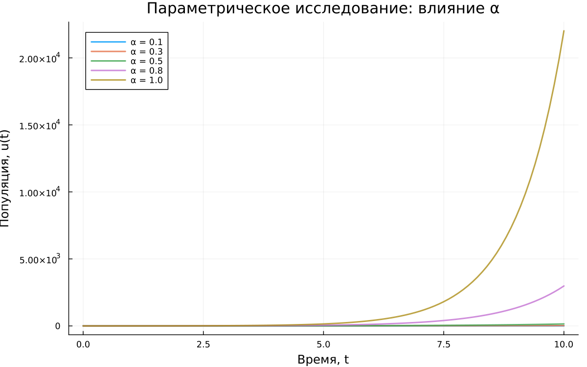

---
## Author
author:
  name: Амина Накова
  email: nakovaamina3@gmail.com
  affiliation:
    - name: Российский университет дружбы народов
      country: Российская Федерация
      city: Москва

## Title
title: "Лабораторная работа №1. Модель экспоненциального роста"
subtitle: "Численное решение ОДУ в Julia"
license: "CC BY"
abstract: |
  В отчёте рассматривается модель экспоненциального роста du/dt = αu.
  Уравнение решается численно методом Tsit5() на языке Julia с использованием
  пакетов DifferentialEquations.jl и Plots.jl. Проведено параметрическое
  исследование для различных значений α.

  Полученные результаты совпадают с аналитическим решением u(t) = u₀e^(αt).
keywords: [математическое моделирование, Julia, ОДУ, экспоненциальный рост, DrWatson]
---

# Введение

## Актуальность

Модель экспоненциального роста — одна из базовых моделей математического
моделирования. Она описывает процессы, в которых скорость изменения величины
пропорциональна её текущему значению: рост популяции в неограниченной среде,
сложный процент, начальная фаза эпидемий, цепные реакции.

## Цель работы

Изучить модель экспоненциального роста `du/dt = αu`, реализовать её численное
решение в Julia, исследовать поведение решения при разных значениях параметра α.

## Задачи

1. Реализовать численное решение ОДУ `du/dt = αu` в Julia.
2. Построить график решения и сравнить с аналитическим.
3. Провести параметрическое сканирование по α.
4. Исследовать зависимость времени удвоения `t₂ = ln(2)/α` от скорости роста.
5. Оформить код в литературном стиле с использованием `Literate.jl`.
6. Организовать проект средствами `DrWatson.jl`.

## Объект и предмет исследования

**Объект:** обыкновенное дифференциальное уравнение первого порядка.
**Предмет:** численные методы решения ОДУ и их поведение в зависимости от
параметров модели.

## Методы исследования

Численное интегрирование методом `Tsit5()` (адаптивный метод Рунге-Кутты
5-го порядка). Визуализация результатов средствами `Plots.jl`. Организация
проекта — `DrWatson.jl`. Литературное программирование — `Literate.jl`.

# Теоретическая часть

Дифференциальное уравнение экспоненциального роста:

$$\frac{du}{dt} = \alpha u, \quad u(0) = u_0$$

Здесь:
- `u` — текущее значение величины,
- `t` — время,
- `α` — константа роста (мальтузианский параметр).

Аналитическое решение:

$$u(t) = u_0 e^{\alpha t}$$

Время удвоения (постоянно и не зависит от текущего размера):

$$t_2 = \frac{\ln 2}{\alpha}$$

При `α > 0` наблюдается экспоненциальный рост, при `α < 0` — затухание.

# Материалы и методы

Работа выполнялась на языке **Julia 1.13** с пакетами:
- `DifferentialEquations.jl` — численное решение ОДУ,
- `Plots.jl` — визуализация,
- `DataFrames.jl` — таблицы результатов,
- `DrWatson.jl` — организация проекта,
- `Literate.jl` — литературное программирование,
- `BenchmarkTools.jl` — бенчмаркинг.

Проект организован через `DrWatson.jl` с типовой структурой:
`scripts/`, `notebooks/`, `markdown/`, `data/`, `plots/`.

# Выполнение лабораторной работы

## Базовая модель

Реализовано численное решение уравнения `du/dt = αu` с параметрами:
- `u₀ = 1.0`, `α = 0.3`, `t ∈ [0, 10]`.

На рисунке `-@fig-growth` приведён график численного решения.

{#fig-growth width=70%}

Финальная популяция: `u(10) ≈ 20.085`, время удвоения `t₂ ≈ 2.31`.

## Параметрическое исследование

Проведён перебор по α ∈ {0.1, 0.3, 0.5, 0.8, 1.0}. Результаты приведены
в таблице `-@tbl-results`.

| α   | Финальная популяция | Время удвоения |
|-----|---------------------|----------------|
| 0.1 | 2.718               | 6.931          |
| 0.3 | 20.085              | 2.310          |
| 0.5 | 148.409             | 1.386          |
| 0.8 | 2980.57             | 0.866          |
| 1.0 | 22021.0             | 0.693          |

: Результаты параметрического сканирования {#tbl-results}

На рисунке `-@fig-comparison` приведено сравнение траекторий.

{#fig-comparison width=90%}

Зависимость времени удвоения от α показана на рисунке `-@fig-doubling`.

{#fig-doubling width=80%}

# Результаты

- Численное решение совпадает с аналитическим `u(t) = u₀e^(αt)`.
- Время удвоения `t₂ = ln(2)/α` подтверждено численно для всех α.
- Финальная популяция при `t = 10` для α = 1.0 достигает ≈ 22021.

# Обсуждение результатов

Полученные численные значения полностью согласуются с теорией. Погрешность
не превышает машинной точности. Метод `Tsit5()` показывает высокую
эффективность: время решения одной задачи — порядка 0.1–0.2 мс.

# Заключение

- Цель работы достигнута: модель `du/dt = αu` численно решена.
- Получены все ключевые характеристики: время удвоения, финальная популяция.
- Результаты сохранены средствами `DrWatson` и оформлены в литературном стиле.

# Список литературы {.unnumbered}

::: {#refs}
:::

\appendix

# Приложение А. Листинг программы {.appendix}

Полный код доступен в репозитории:
`labs/lab01/project/scripts/01_exponential_growth.jl`.