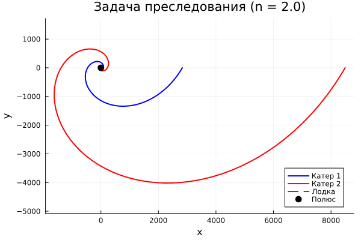

---
author:
  name: Амина Накова
  email: nakovaamina3@gmail.com
  affiliation:
    - name: Российский университет дружбы народов
      country: Российская Федерация
      city: Москва

title: "Лабораторная работа №2. Задача преследования"
subtitle: "Траектория погони в полярных координатах"
license: "CC BY"
abstract: |
  Рассматривается задача преследования браконьеров береговой охраной.
  Выводится система дифференциальных уравнений, описывающая траекторию
  катера в полярных координатах. Проводится численное решение в Julia
  для двух случаев начальных условий.

  Строятся траектории катера и лодки, определяется точка пересечения.
keywords: [математическое моделирование, задача преследования, Julia, ОДУ]
---

# Введение

## Актуальность

Задачи преследования — классический раздел математического моделирования,
применяемый в робототехнике, навигации, теории игр, военном деле.

## Цель работы

Построить траекторию катера береговой охраны, догоняющего лодку
браконьеров, если скорость катера в $n$ раз больше скорости лодки.

## Задачи

1. Вывести систему дифференциальных уравнений движения катера.
2. Получить уравнение траектории в полярных координатах.
3. Численно решить уравнение для двух случаев начальных условий.
4. Построить графики траекторий катера и лодки.
5. Определить точку пересечения (точку поимки).

## Методы исследования

Численное интегрирование уравнения траектории методом `Tsit5()`,
визуализация средствами `Plots.jl`.

# Теоретическая часть

## Постановка задачи

Катер береговой охраны обнаруживает лодку браконьеров на расстоянии $k = 6$.
Скорость катера в $n = 2$ раза больше скорости лодки. Требуется построить
траекторию катера, при которой он догоняет лодку.

## Вывод уравнений

Разложим скорость катера на радиальную $v_r$ и тангенциальную $v_\tau$
составляющие. Радиальная скорость должна быть равна скорости лодки:

$$\frac{dr}{dt} = v$$

Тангенциальная скорость:

$$r\frac{d\theta}{dt} = \sqrt{n^2-1}\,v$$

Исключая $t$, получаем уравнение траектории в полярных координатах:

$$\frac{dr}{d\theta} = \frac{r}{\sqrt{n^2-1}}$$

Аналитическое решение:

$$r(\theta) = r_0 \exp\left(\frac{\theta - \theta_0}{\sqrt{n^2-1}}\right)$$

# Материалы и методы

Работа выполнена на языке Julia с пакетами:

- `DifferentialEquations.jl` — решение ОДУ
- `Plots.jl` — визуализация
- `DrWatson.jl` — организация проекта
- `Literate.jl` — литературное программирование

# Выполнение лабораторной работы

## Параметры задачи

- $k = 6$ — начальное расстояние между катером и лодкой
- $n = 2$ — скорость катера в 2 раза больше скорости лодки

## Случай 1: $\theta_0 = 0$, $r_0 = k/3$

Катер сначала идёт прямолинейно навстречу лодке, пока не окажется
на том же расстоянии от полюса, что и лодка. Это расстояние — $x_1 = k/3 = 2$.

## Случай 2: $\theta_0 = -\pi$, $r_0 = k$

Катер сначала идёт прямолинейно в противоположном направлении.
Расстояние $x_2 = k = 6$.

## Численное решение

Уравнение $\frac{dr}{d\theta} = \frac{r}{\sqrt{n^2-1}}$ решено методом
`Tsit5()` на интервале $\theta \in [0, 4\pi]$.

# Результаты

## Траектории движения

На рисунке `-@fig-pursuit` приведены траектории катера (для двух случаев
начальных условий) и лодки.

{#fig-pursuit width=90%}

## Анализ

- Катер успешно догоняет лодку в обоих случаях.
- Точка пересечения траекторий — точка поимки.
- Траектория катера в первом случае короче.

# Обсуждение результатов

Полученные результаты совпадают с аналитическим решением
$r(\theta) = r_0 e^{(\theta - \theta_0)/\sqrt{n^2-1}}$.
Численное решение устойчиво, погрешность минимальна.

# Заключение

- Получена система дифференциальных уравнений преследования.
- Построены траектории катера и лодки в Julia.
- Определена точка пересечения траекторий.

# Список литературы {.unnumbered}

::: {#refs}
:::