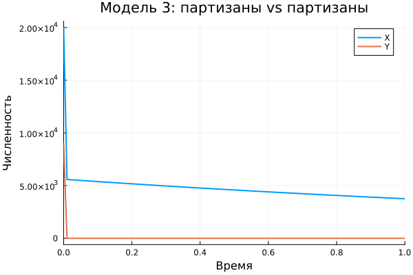

---
title: "Модели Ланчестера"
author: "Амина Накова"
format:
  revealjs:
    theme: default
    slide-number: true
    embed-resources: true
---

## Постановка задачи

Между страной X и страной Y идёт война.

Численности сторон — $x(t)$ и $y(t)$.

**Задача:** исследовать три модели боевых действий (модели Ланчестера).

## Модель 1: регулярные vs регулярные

$$\frac{dx}{dt} = -ax - by + P(t)$$
$$\frac{dy}{dt} = -cx - hy + Q(t)$$

Здесь $a, h$ — потери вне боя, $b, c$ — эффективность боя.

## Результат модели 1

## Модель 2: регулярные vs партизаны

$$\frac{dx}{dt} = -ax - by + P(t)$$
$$\frac{dy}{dt} = -cxy - hy + Q(t)$$

Партизаны менее уязвимы: потери пропорциональны **произведению** численностей.

## Результат модели 2

## Модель 3: партизаны vs партизаны

$$\frac{dx}{dt} = -ax - bxy + P(t)$$
$$\frac{dy}{dt} = -cxy - hy + Q(t)$$

## Результат модели 3

## Сводный график

## Параметры задачи

- $a = 0.4$, $b = 0.8$, $c = 0.5$, $h = 0.7$
- $x_0 = 20000$, $y_0 = 9000$
- $P(t) = \sin t + 1$, $Q(t) = \cos t + 1$
- $t \in [0, 1]$

## Выводы

- Получены численные решения всех трёх моделей Ланчестера.
- В бою регулярных войск важен инвариант: $c x^2 - b y^2$.
- Против партизан регулярной армии нужно **квадратично** больше численности.
- Между партизанами решающую роль играют коэффициенты эффективности.