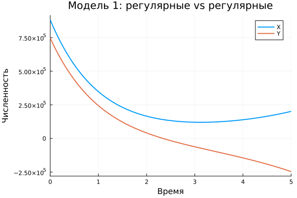
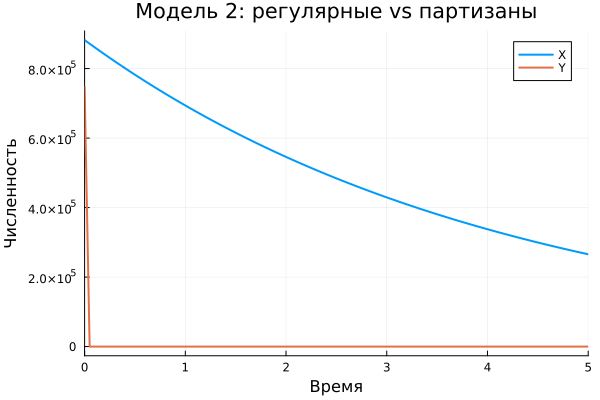
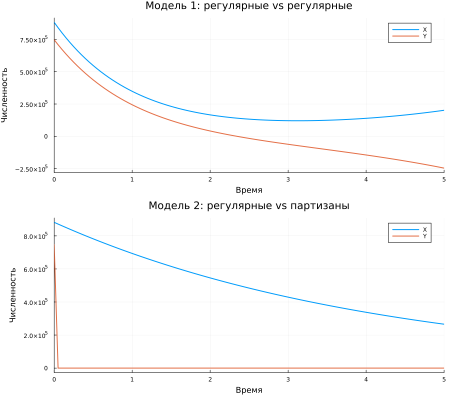

---
title: "Модели Ланчестера"
author: "Амина Накова"
subtitle: "Вариант 38"
format:
  revealjs:
    theme: default
    slide-number: true
    embed-resources: true
---

## Постановка задачи

- Страна X: 882 000 человек
- Страна Y: 747 000 человек

Две модели боевых действий (вариант 38).

## Модель 1: регулярные vs регулярные

$$\frac{dx}{dt} = -0.4x - 0.67y + \sin(3t) + 1$$
$$\frac{dy}{dt} = -0.77x - 0.14y + \cos(2t) + 2$$

## Модель 2: регулярные vs партизаны

$$\frac{dx}{dt} = -0.24x - 0.67y + |\sin(2t)|$$
$$\frac{dy}{dt} = -0.47xy - 0.14y + |\cos(2t)|$$

## Сводный график

## Выводы

- Решены две модели Ланчестера для варианта 38.
- Победитель определяется финальными численностями.
- Партизанская модель учитывает квадратичный эффект $xy$.