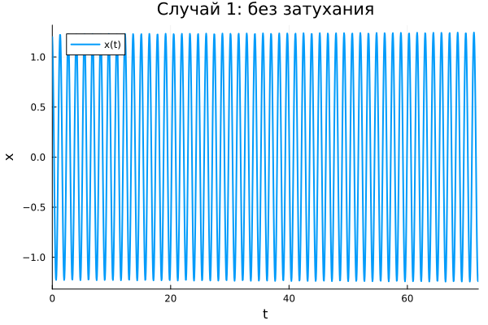
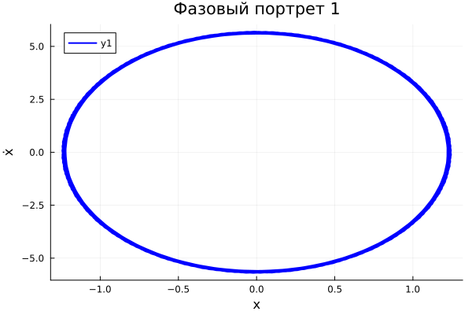
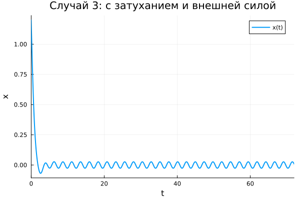

## Постановка задачи

Модель линейного гармонического осциллятора:

$$\ddot{x} + 2\gamma\dot{x} + \omega_0^2 x = f(t)$$

Начальные условия: $x_0 = 1.2$, $y_0 = -1.2$. Время: $t \in [0; 72]$.

## Случай 1: без затухания

Уравнение: $\ddot{x} + 21x = 0$

## Фазовый портрет 1

Замкнутая кривая — энергия сохраняется.

## Случай 2: с затуханием

Уравнение: $\ddot{x} + 2.2\dot{x} + 2.3x = 0$

## Фазовый портрет 2

Сходящаяся спираль — колебания затухают.

## Случай 3: с затуханием и внешней силой

Уравнение: $\ddot{x} + 2.4\dot{x} + 2.5x = 0.2\sin(2.6t)$

## Фазовый портрет 3

Установившийся режим вынужденных колебаний.

## Выводы

- Случай 1: амплитуда постоянна.
- Случай 2: амплитуда убывает.
- Случай 3: устанавливаются вынужденные колебания.
- Фазовые портреты качественно подтверждают теорию.