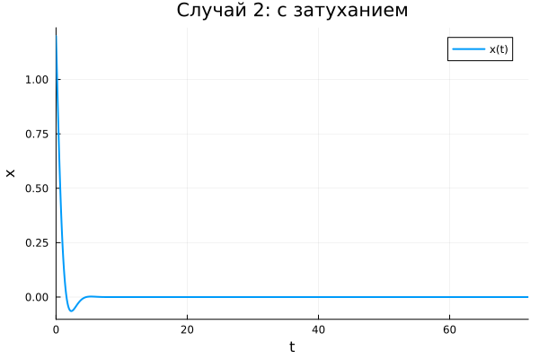
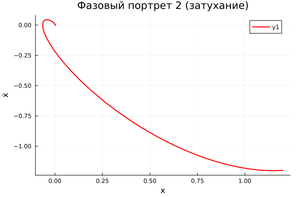
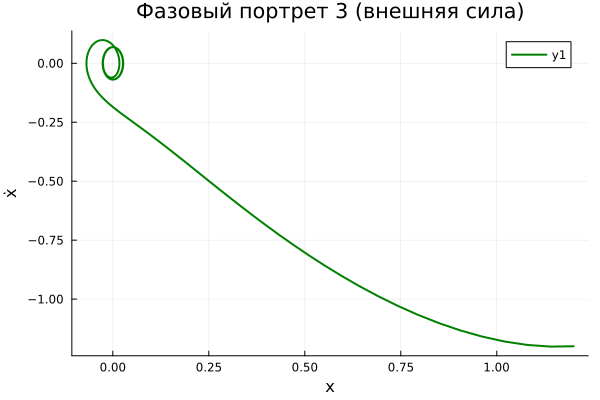
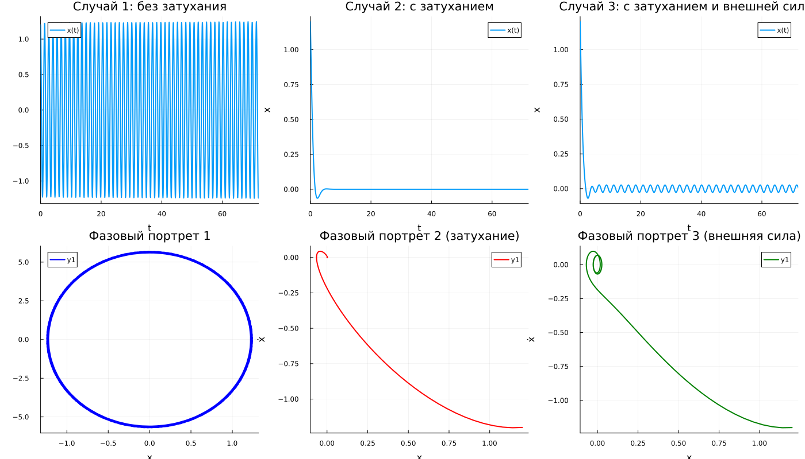

---
author:
  name: Амина Накова
  email: nakovaamina3@gmail.com
  affiliation:
    - name: Российский университет дружбы народов
      country: Российская Федерация
      city: Москва

title: "Лабораторная работа №4. Гармонический осциллятор"
subtitle: "Вариант 38"
license: "CC BY"
abstract: |
  Исследуется линейный гармонический осциллятор в трёх режимах:
  без затухания и внешней силы, с затуханием, с затуханием и внешней силой.
  Для каждого случая строится решение уравнения и фазовый портрет.
  Параметры заданы согласно варианту 38.
keywords: [математическое моделирование, гармонический осциллятор, фазовый портрет, Julia]
---

# Введение

## Актуальность

Модель гармонического осциллятора описывает колебания в самых разных
физических системах: грузик на пружине, математический маятник, заряд
в электрическом контуре, а также множество процессов в физике, химии
и биологии.

## Цель работы

Построить решения уравнения гармонического осциллятора и его фазовые
портреты для трёх случаев, предусмотренных заданием (вариант 38).

## Задачи

1. Решить уравнение гармонического осциллятора без затухания.
2. Решить уравнение с затуханием.
3. Решить уравнение с затуханием и внешней силой.
4. Построить фазовые портреты для каждого случая.

## Методы исследования

Численное интегрирование систем ОДУ методом `Tsit5()`,
визуализация средствами `Plots.jl`.

# Теоретическая часть

## Основная модель

Уравнение свободных колебаний гармонического осциллятора:

$$\ddot{x} + 2\gamma\dot{x} + \omega_0^2 x = 0$$

где $\gamma$ — параметр потерь, $\omega_0$ — собственная частота.

## Переход к системе первого порядка

Уравнение второго порядка сводится к системе:

$$\begin{cases} \dot{x} = y \\ \dot{y} = -\omega_0^2 x - 2\gamma y + f(t) \end{cases}$$

## Фазовый портрет

Точки $(x, y)$ образуют фазовую плоскость. Кривые на ней — фазовые
траектории; их совокупность — фазовый портрет.

## Параметры варианта 38

- Начальные условия: $x_0 = 1.2$, $y_0 = -1.2$
- Время: $t \in [0; 72]$
- Случай 1: $\ddot{x} + 21x = 0$
- Случай 2: $\ddot{x} + 2.2\dot{x} + 2.3x = 0$
- Случай 3: $\ddot{x} + 2.4\dot{x} + 2.5x = 0.2\sin(2.6t)$

# Материалы и методы

Работа выполнена на языке Julia 1.13 с пакетами:

- `DifferentialEquations.jl` — решение ОДУ
- `Plots.jl` — визуализация
- `DrWatson.jl` — организация проекта
- `Literate.jl` — литературное программирование

# Выполнение лабораторной работы

## Случай 1: без затухания и без внешней силы

Решение уравнения:

{#fig-sol1 width=90%}

Фазовый портрет:

{#fig-ph1 width=70%}

Фазовый портрет — эллипс: энергия сохраняется.

## Случай 2: с затуханием, без внешней силы

Решение уравнения:

{#fig-sol2 width=90%}

Фазовый портрет:

{#fig-ph2 width=70%}

Фазовый портрет — скручивающаяся спираль: колебания затухают.

## Случай 3: с затуханием и внешней силой

Решение уравнения:

{#fig-sol3 width=90%}

Фазовый портрет:

{#fig-ph3 width=70%}

При наличии внешней силы решение выходит на установившийся режим
вынужденных колебаний.

## Сводный график

{#fig-all width=100%}

# Результаты

- Случай 1: амплитуда постоянна, энергия сохраняется.
- Случай 2: амплитуда убывает, колебания затухают.
- Случай 3: устанавливается режим вынужденных колебаний.

# Обсуждение результатов

Результаты полностью соответствуют теории:

- фазовый портрет без затухания — замкнутая кривая;
- с затуханием — сходящаяся спираль;
- с внешней силой — установившиеся колебания.

# Заключение

- Решены три задачи о гармоническом осцилляторе.
- Построены решения и фазовые портреты.
- Проведён анализ поведения системы в каждом случае.

# Список литературы {.unnumbered}

::: {#refs}
:::