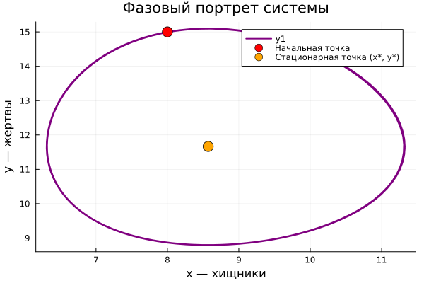

## Постановка задачи

Модель Лотки-Вольтерры:

$$\begin{cases} \dfrac{dx}{dt} = -ax + bxy \\[4pt] \dfrac{dy}{dt} = cy - dxy \end{cases}$$

где $x$ — хищники, $y$ — жертвы.

## Параметры варианта 38

- $a = 0.7$, $b = 0.06$, $c = 0.6$, $d = 0.07$
- Начальные условия: $x_0 = 8$, $y_0 = 15$
- Время: $t \in [0; 100]$

## Динамика хищников

## Динамика жертв

## Совмещённый график

## Фазовый портрет

## Стационарное состояние

$$x^* = \frac{c}{d} \approx 8.571, \quad y^* = \frac{a}{b} \approx 11.667$$

## Выводы

- Численности хищников и жертв колеблются в противофазе.
- Фазовый портрет — замкнутая кривая (цикл).
- Система совершает незатухающие колебания вокруг стационарной точки.