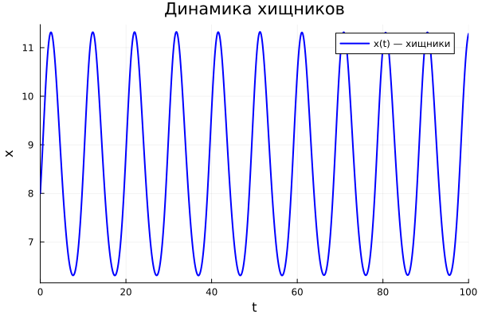
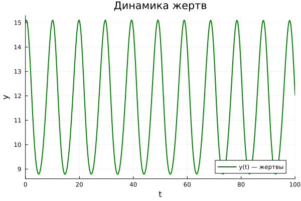
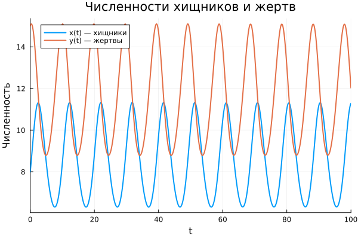

---
author:
  name: Амина Накова
  email: nakovaamina3@gmail.com
  affiliation:
    - name: Российский университет дружбы народов
      country: Российская Федерация
      city: Москва

title: "Лабораторная работа №5. Модель «хищник-жертва»"
subtitle: "Вариант 38"
license: "CC BY"
abstract: |
  Исследуется модель Лотки-Вольтерры «хищник-жертва» для варианта 38.
  Построены графики изменения численностей хищников и жертв во времени,
  фазовый портрет системы, найдено стационарное состояние.
keywords: [математическое моделирование, Лотка-Вольтерра, хищник-жертва, Julia]
---

# Введение

## Актуальность

Модель «хищник-жертва» — классическая модель взаимодействия двух видов.
Она применяется в экологии, биологии, экономике.

## Цель работы

Построить графики динамики численностей хищников и жертв, фазовый
портрет системы и найти стационарное состояние (вариант 38).

## Задачи

1. Записать систему уравнений Лотки-Вольтерры.
2. Решить её численно в Julia.
3. Построить графики x(t) и y(t).
4. Построить фазовый портрет.
5. Найти стационарное состояние.

## Методы исследования

Численное интегрирование методом `Tsit5()`, визуализация `Plots.jl`.

# Теоретическая часть

## Модель Лотки-Вольтерры

$$\begin{cases} \dfrac{dx}{dt} = -ax + bxy \\[4pt] \dfrac{dy}{dt} = cy - dxy \end{cases}$$

где $x$ — численность хищников, $y$ — численность жертв,
$a, d$ — коэффициенты смертности, $b, c$ — коэффициенты прироста.

## Стационарное состояние

Из условий $\dot{x} = \dot{y} = 0$:

$$x^* = \frac{c}{d}, \quad y^* = \frac{a}{b}$$

# Материалы и методы

Работа выполнена на языке Julia 1.13 с пакетами:

- `DifferentialEquations.jl`
- `Plots.jl`
- `DrWatson.jl`
- `Literate.jl`

## Параметры варианта 38

- $a = 0.7$, $b = 0.06$, $c = 0.6$, $d = 0.07$
- Начальные условия: $x_0 = 8$, $y_0 = 15$
- Время: $t \in [0; 100]$

# Выполнение лабораторной работы

## Динамика численности хищников x(t)

{#fig-x width=90%}

## Динамика численности жертв y(t)

{#fig-y width=90%}

## Совмещённый график x(t) и y(t)

{#fig-xy width=90%}

## Фазовый портрет

{#fig-phase width=80%}

Фазовый портрет — замкнутая кривая (цикл). Колебания численностей
происходят в противофазе.

# Результаты

- Стационарное состояние: $x^* = c/d \approx 8.571$, $y^* = a/b \approx 11.667$.
- Начальные условия $(x_0, y_0) = (8, 15)$ не совпадают со стационарной точкой,
  поэтому система совершает периодические колебания вокруг неё.
- Амплитуда колебаний определяется начальными условиями.

# Обсуждение результатов

Модель Лотки-Вольтерры показывает, что:

- Численности хищников и жертв колеблются в противофазе.
- При отклонении от стационарного состояния система не стремится вернуться
  к нему, а совершает незатухающие колебания (жёсткая модель).
- В реальности модель требует учёта дополнительных факторов.

# Заключение

- Система Лотки-Вольтерры решена численно.
- Построены графики x(t), y(t) и фазовый портрет.
- Найдено стационарное состояние системы.

# Список литературы {.unnumbered}

::: {#refs}
:::