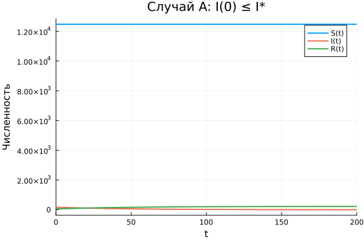
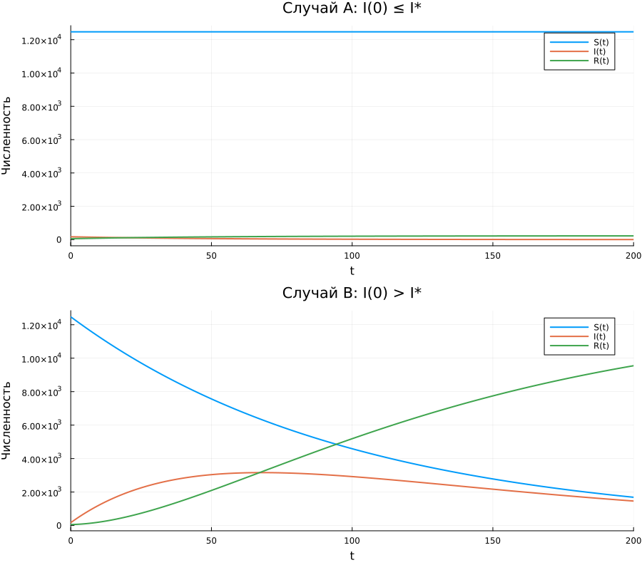

---
title: "Задача об эпидемии"
author: "Амина Накова"
subtitle: "Вариант 38"
format:
  revealjs:
    theme: default
    slide-number: true
    embed-resources: true
---

## Постановка задачи

Популяция разделена на три группы:

- $S(t)$ — восприимчивые
- $I(t)$ — инфицированные
- $R(t)$ — выздоровевшие с иммунитетом

## Параметры варианта 38

- $N = 12700$, $I(0) = 170$, $R(0) = 57$
- $S(0) = 12473$
- $\alpha = 0.01$, $\beta = 0.02$, $I^* = 100$
- $t \in [0; 200]$

## Случай A: I(0) ≤ I*

Уравнения: $\dot{S} = 0$, $\dot{I} = -\beta I$, $\dot{R} = \beta I$

## Случай B: I(0) > I*

Уравнения: $\dot{S} = -\alpha S$, $\dot{I} = \alpha S - \beta I$, $\dot{R} = \beta I$

## Сводный график

## Выводы

- При $I(0) \le I^*$ эпидемия затухает за счёт изоляции.
- При $I(0) > I^*$ наблюдается классический SIR-пик.
- Порог $S = \beta/\alpha$ определяет развитие эпидемии.