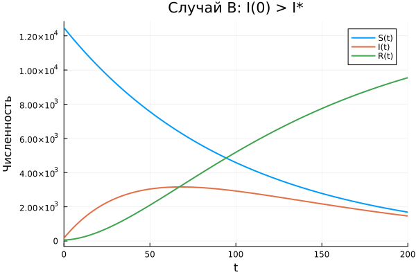

---
author:
  name: Амина Накова
  email: nakovaamina3@gmail.com
  affiliation:
    - name: Российский университет дружбы народов
      country: Российская Федерация
      city: Москва

title: "Лабораторная работа №6. Задача об эпидемии"
subtitle: "Вариант 38"
license: "CC BY"
abstract: |
  Рассматривается простейшая модель эпидемии (SIR). Популяция разделена
  на три группы: восприимчивые S(t), инфицированные I(t), выздоровевшие
  с иммунитетом R(t). Анализируются два случая: I(0) ≤ I* и I(0) > I*.
keywords: [математическое моделирование, эпидемия, SIR, Julia]
---

# Введение

## Актуальность

Модели эпидемий — классический раздел математической биологии и
эпидемиологии. Они применяются для прогнозирования распространения
инфекций и оценки мер контроля.

## Цель работы

Построить графики изменения численностей трёх групп (S, I, R) для двух
случаев: когда начальное число инфицированных не превышает критического
значения I*, и когда превышает.

## Задачи

1. Записать систему уравнений SIR-модели.
2. Решить её численно для двух случаев.
3. Построить графики S(t), I(t), R(t).
4. Проанализировать динамику эпидемии.

## Методы исследования

Численное интегрирование методом `Tsit5()`, визуализация `Plots.jl`.

# Теоретическая часть

## Модель эпидемии

Популяция разбита на три группы:
- $S(t)$ — восприимчивые, но пока здоровые;
- $I(t)$ — инфицированные (распространители);
- $R(t)$ — выздоровевшие с иммунитетом.

**Случай A (I(0) ≤ I*):** все больные изолированы. Уравнения:

$$\frac{dS}{dt} = 0, \quad \frac{dI}{dt} = -\beta I, \quad \frac{dR}{dt} = \beta I$$

**Случай B (I(0) > I*):** эпидемия развивается. Уравнения:

$$\frac{dS}{dt} = -\alpha S, \quad \frac{dI}{dt} = \alpha S - \beta I, \quad \frac{dR}{dt} = \beta I$$

где $\alpha$ — коэффициент заболеваемости, $\beta$ — коэффициент выздоровления.

# Материалы и методы

Работа выполнена на языке Julia 1.13 с пакетами:

- `DifferentialEquations.jl`
- `Plots.jl`
- `DrWatson.jl`
- `Literate.jl`

## Параметры варианта 38

- $N = 12700$, $I(0) = 170$, $R(0) = 57$
- $S(0) = N - I(0) - R(0) = 12473$
- $\alpha = 0.01$, $\beta = 0.02$, $I^* = 100$
- $t \in [0; 200]$

# Выполнение лабораторной работы

## Случай A: I(0) ≤ I*

{#fig-A width=90%}

Число восприимчивых S(t) не меняется; инфицированные монотонно убывают
(все изолированы и лечатся); выздоровевшие R(t) растут.

## Случай B: I(0) > I*

{#fig-B width=90%}

Восприимчивые S(t) убывают, инфицированные I(t) сначала растут,
затем достигают максимума и падают; выздоровевшие R(t) растут.

## Сводный график

{#fig-all width=90%}

# Результаты

- **Случай A:** эпидемия сдерживается, новых заражений нет.
- **Случай B:** эпидемия развивается, наблюдается пик заболеваемости.
- Пик приходится на момент, когда $S = \beta/\alpha$ (пороговое условие).

# Обсуждение результатов

Модель показывает, что:

- При $I(0) \le I^*$ эпидемия быстро затухает за счёт изоляции больных.
- При $I(0) > I^*$ наблюдается классическая динамика SIR с пиком.
- Пороговое условие $S > \beta/\alpha$ определяет развитие эпидемии.

# Заключение

- Система SIR решена численно для двух случаев.
- Построены графики S(t), I(t), R(t).
- Проанализирована динамика эпидемии.

# Список литературы {.unnumbered}

::: {#refs}
:::