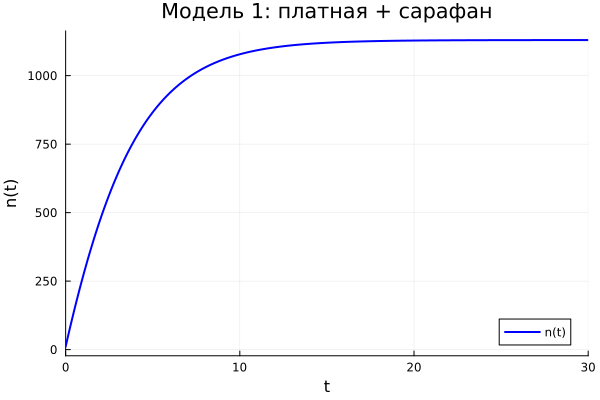

## Постановка задачи

Модель распространения рекламы:

$$\frac{dn}{dt} = (\alpha_1(t) + \alpha_2(t)n(t))(N - n(t))$$

- $N = 1130$, $n(0) = 11$
- $t \in [0; 30]$

## Модель 1: платная + сарафан

$$\frac{dn}{dt} = (0.25 + 0.000075n)(N - n)$$

## Модель 2: только платная

$$\frac{dn}{dt} = (0.000075 + 0.25n)(N - n)$$

## Модель 3: платная(sin) + сарафан(t·n)

$$\frac{dn}{dt} = (0.25\sin t + 0.75\,t\,n)(N - n)$$

## Сводный график

## Выводы

- Модель 1 — логистическая кривая.
- Модель 2 — быстрый рост и быстрое насыщение; определён $t_{max}$.
- Модель 3 — периодическая начальная стадия.