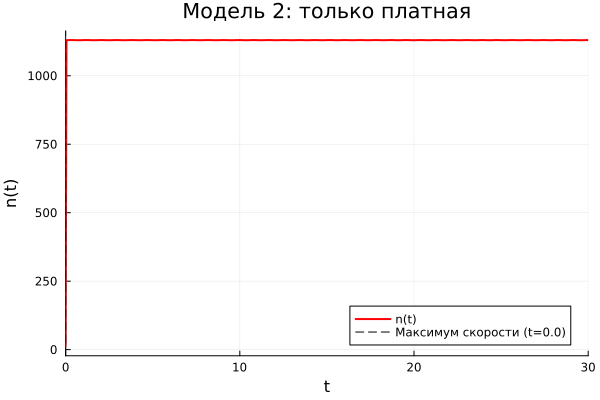
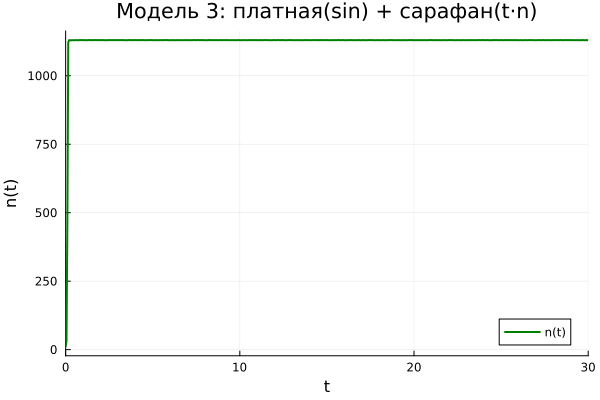
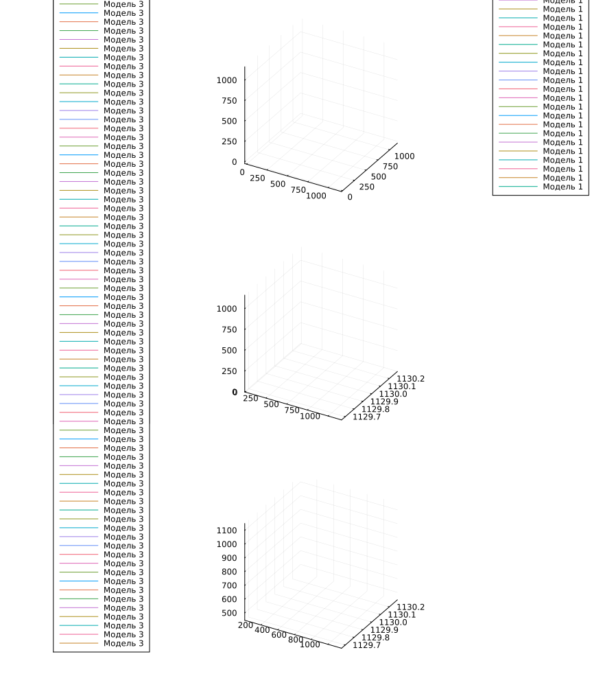

---
author:
  name: Амина Накова
  email: nakovaamina3@gmail.com
  affiliation:
    - name: Российский университет дружбы народов
      country: Российская Федерация
      city: Москва

title: "Лабораторная работа №7. Модель распространения рекламы"
subtitle: "Вариант 38"
license: "CC BY"
abstract: |
  Исследуется модель распространения рекламы о новом товаре.
  Рассматриваются три случая: платная реклама + сарафанное радио,
  только платная реклама, платная (синусоидальная) + сарафанное радио
  (пропорциональное t·n). Для случая 2 определяется момент максимальной
  скорости распространения.
keywords: [математическое моделирование, реклама, логистическая кривая, Julia]
---

# Введение

## Актуальность

Модель распространения рекламы — важный инструмент маркетинга.
Она позволяет прогнозировать охват аудитории и оптимизировать затраты
на рекламную кампанию.

## Цель работы

Построить графики распространения рекламы для трёх моделей,
сравнить эффективность и определить момент максимальной скорости
распространения для случая 2.

## Задачи

1. Записать модель распространения рекламы.
2. Решить её численно для трёх случаев.
3. Построить графики n(t).
4. Определить момент максимальной скорости для случая 2.
5. Сравнить три модели.

## Методы исследования

Численное интегрирование методом `Tsit5()`, визуализация `Plots.jl`.

# Теоретическая часть

## Модель распространения рекламы

$$\frac{dn}{dt} = (\alpha_1(t) + \alpha_2(t)n(t))(N - n(t))$$

где:
- $n(t)$ — число знающих о товаре;
- $N$ — общий объём аудитории;
- $\alpha_1(t)$ — интенсивность платной рекламы;
- $\alpha_2(t)$ — интенсивность «сарафанного радио».

## Предельные случаи

- $\alpha_1 \gg \alpha_2$ → модель Мальтуса (экспоненциальный рост);
- $\alpha_1 \ll \alpha_2$ → логистическая кривая.

# Материалы и методы

Работа выполнена на языке Julia 1.13 с пакетами
`DifferentialEquations.jl`, `Plots.jl`, `DrWatson.jl`, `Literate.jl`.

## Параметры варианта 38

- $N = 1130$, $n(0) = 11$
- $t \in [0; 30]$

# Выполнение лабораторной работы

## Модель 1: платная + сарафанное радио

$$\frac{dn}{dt} = (0.25 + 0.000075\,n)(N - n)$$

{#fig-m1 width=90%}

## Модель 2: только платная реклама

$$\frac{dn}{dt} = (0.000075 + 0.25\,n)(N - n)$$

{#fig-m2 width=90%}

Для модели 2 определён момент максимальной скорости роста $t_{max}$.
Он отмечен вертикальной штриховой линией на графике.

## Модель 3: платная (sin) + сарафан (t·n)

$$\frac{dn}{dt} = (0.25\sin t + 0.75\,t\,n)(N - n)$$

{#fig-m3 width=90%}

## Сводный график

{#fig-all width=90%}

# Результаты

- Модель 1: логистическая кривая, плавный выход на насыщение.
- Модель 2: крутой рост в начале, затем быстрое насыщение.
- Модель 3: периодический характер начальной стадии.
- Для модели 2 момент максимальной скорости определён численно.

# Обсуждение результатов

Модель 2 (с преобладанием платной рекламы) показывает быстрое
распространение информации. Модель 1 (с сарафанным радио) даёт более
плавный рост. Модель 3 демонстрирует влияние периодической компоненты.

# Заключение

- Все три модели решены численно.
- Построены графики n(t) для каждой модели.
- Для модели 2 определено $t_{max}$ — момент максимальной скорости.

# Список литературы {.unnumbered}

::: {#refs}
:::