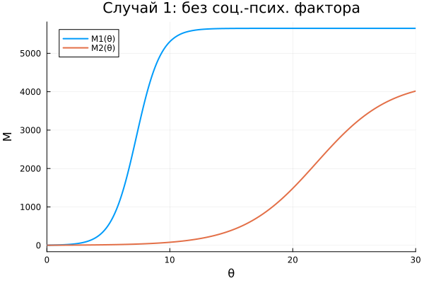
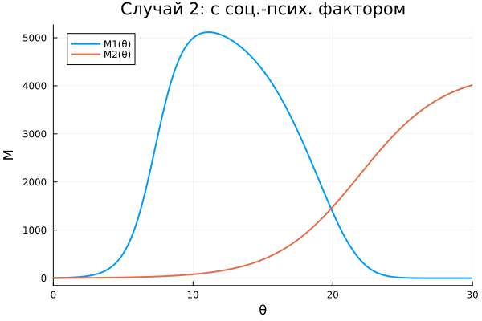
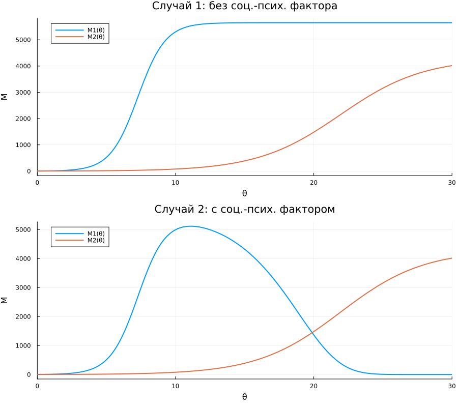

---
author:
  name: Амина Накова
  email: nakovaamina3@gmail.com
  affiliation:
    - name: Российский университет дружбы народов
      country: Российская Федерация
      city: Москва

title: "Лабораторная работа №8. Модель конкуренции двух фирм"
subtitle: "Вариант 38"
license: "CC BY"
abstract: |
  Исследуется модель конкуренции двух фирм, производящих взаимозаменяемые
  товары в одной рыночной нише. Рассматриваются два случая: без учёта
  социально-психологического фактора и с его учётом.
keywords: [математическое моделирование, конкуренция, оборотные средства, Julia]
---

# Введение

## Актуальность

Модели конкуренции двух фирм — классический раздел математической
экономики. Они применяются для анализа рыночных стратегий и устойчивости
предприятий.

## Цель работы

Построить графики изменения оборотных средств двух конкурирующих фирм
для двух случаев: без социально-психологического фактора и с ним.

## Задачи

1. Записать систему уравнений динамики оборотных средств двух фирм.
2. Решить её численно для двух случаев.
3. Построить графики M₁(θ), M₂(θ).
4. Проанализировать результаты.

## Методы исследования

Численное интегрирование методом `Tsit5()`, визуализация `Plots.jl`.

# Теоретическая часть

## Модель одной фирмы

$$\frac{dM}{dt} = -\frac{M\delta}{\tau} + Nq\left(1 - \frac{p}{p_{cr}}\right)p - \kappa$$

## Случай 1: без социально-психологического фактора

$$\frac{dM_1}{d\theta} = M_1 - \frac{b}{c_1}M_1M_2 - \frac{a_1}{c_1}M_1^2$$
$$\frac{dM_2}{d\theta} = \frac{c_2}{c_1}M_2 - \frac{b}{c_1}M_1M_2 - \frac{a_2}{c_1}M_2^2$$

## Случай 2: с социально-психологическим фактором

$$\frac{dM_1}{d\theta} = M_1 - \left(\frac{b}{c_1} + 0.00083\right)M_1M_2 - \frac{a_1}{c_1}M_1^2$$
$$\frac{dM_2}{d\theta} = \frac{c_2}{c_1}M_2 - \frac{b}{c_1}M_1M_2 - \frac{a_2}{c_1}M_2^2$$

# Материалы и методы

Работа выполнена на языке Julia 1.13 с пакетами
`DifferentialEquations.jl`, `Plots.jl`, `DrWatson.jl`, `Literate.jl`.

## Параметры варианта 38

- $M_0^1 = 3.9$, $M_0^2 = 2.9$
- $p_{cr} = 25$, $N = 39$, $q = 1$
- $\tau_1 = 29$, $\tau_2 = 19$
- $\tilde{p}_1 = 6.9$, $\tilde{p}_2 = 15.9$

# Выполнение лабораторной работы

## Случай 1

{#fig-case1 width=90%}

Обе фирмы достигают своих максимальных значений и стабильно работают
на рынке.

## Случай 2

{#fig-case2 width=90%}

Фирма 1 после начального роста теряет оборотные средства и банкротится.
Фирма 2 сохраняет устойчивое положение.

## Сводный график

{#fig-all width=90%}

# Результаты

- Случай 1: обе фирмы устойчивы.
- Случай 2: фирма 1 банкротится, фирма 2 занимает рынок.
- Социально-психологический фактор усиливает конкурентное преимущество.

# Обсуждение результатов

При учёте социально-психологического фактора взаимодействие фирм
усиливается, что может приводить к вытеснению одной из них с рынка.

# Заключение

- Решены две модели конкуренции фирм.
- Построены графики M₁(θ), M₂(θ).
- Проанализировано поведение системы.

# Список литературы {.unnumbered}

::: {#refs}
:::