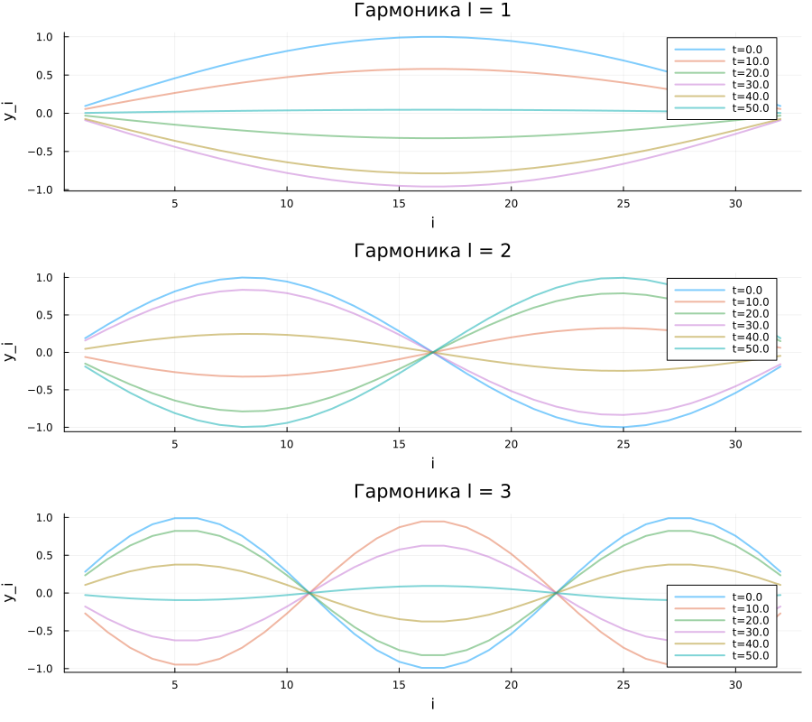

## Итоги проекта

- Реализована модель колебаний цепочек.
- Алгоритм — Верле (скоростная форма).
- Язык — Julia, проект DrWatson.

## Сводный график

## Что удалось

- Получены снимки смещений для трёх гармоник.
- Аналитические частоты совпадают с теорией.
- Модель устойчива на длительных временах.
- Энергия сохраняется.

## Трудности

- Для больших N расчёт $O(N)$ на шаг.
- Малые N дают заметный краевой эффект.
- Нелинейная задача (Ферми–Паста–Улам) — вне рамок проекта.

## Самооценка

- **Модель:** 5/5 — выбрана корректно.
- **Алгоритмы:** 5/5 — Верле реализован.
- **Реализация:** 4/5 — работает, без оптимизации.
- **Презентации:** 5/5 — все 4 этапа представлены.

## Направления развития

- Ангармоническая цепочка (Ферми–Паста–Улам).
- Преобразование Фурье для спектрального анализа.
- Цепочка с чередующимися массами.

## Спасибо за внимание!