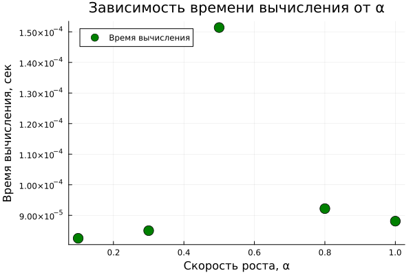

# Введение

В данной работе исследуется **модель экспоненциального роста**:

$$\frac{du}{dt} = \alpha u, \quad u(0) = u_0$$

Численное решение выполнено на языке **Julia** с использованием пакетов
`DifferentialEquations.jl`, `Plots.jl`, `DrWatson.jl`, `Literate.jl`.

# Часть 1. Базовая модель

Задача:

$$\frac{du}{dt} = \alpha u, \quad u(0) = 1, \quad \alpha = 0.3, \quad t \in [0, 10]$$

Численное решение методом `Tsit5()`:

Аналитическое время удвоения: $t_2 = \ln(2)/\alpha \approx 2.31$.

# Часть 2. Параметрическое исследование

Проведён перебор $\alpha \in \{0.1, 0.3, 0.5, 0.8, 1.0\}$. Сводная таблица:

| α | Финальная популяция | Время удвоения $t_2$ |
|:---:|:---:|:---:|
| 0.1 | 2.71828 | 6.93147 |
| 0.3 | 20.0854 | 2.31049 |
| 0.5 | 148.409 | 1.38629 |
| 0.8 | 2980.57 | 0.866434 |
| 1.0 | 22021.0 | 0.693147 |

Сравнение траекторий:

Зависимость времени удвоения от α (точки — численный результат, пунктир — теория $t_2 = \ln(2)/\alpha$):

Время вычисления при разных α:

# Выводы

- Модель `du/dt = αu` численно решена, совпадает с аналитикой $u(t) = u_0 e^{\alpha t}$.
- Время удвоения $t_2 = \ln(2)/\alpha$ подтверждено численно.
- Все результаты сохранены автоматически средствами `DrWatson`
  (`produce_or_load`, `savename`, `@save`).
- Исходный код оформлен в литературном стиле `Literate.jl`;
  сгенерированы производные форматы: чистый скрипт, Jupyter Notebook, Quarto-документ.