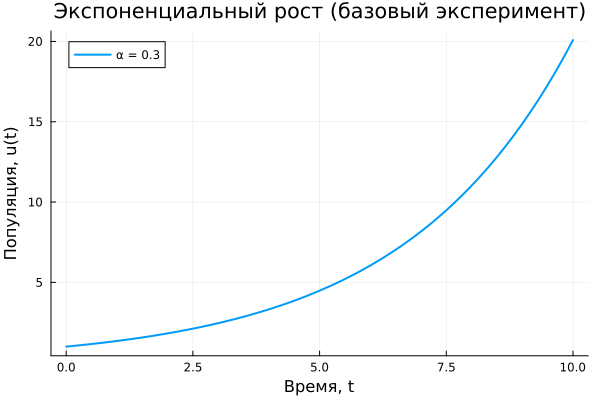
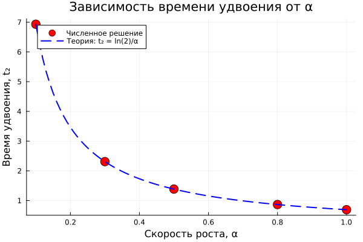

## Введение

Модель экспоненциального роста:

$$\frac{du}{dt} = \alpha u, \quad u(0) = u_0$$

Аналитическое решение: $u(t) = u_0 e^{\alpha t}$.

## Базовая модель

- Начальные условия: $u_0 = 1$, $\alpha = 0.3$
- Временной интервал: $t \in [0, 10]$
- Метод: `Tsit5()` (адаптивный Рунге-Кутта)

## Результат

Время удвоения: $t_2 = \ln(2)/\alpha \approx 2.31$.

## Параметрическое исследование

Перебор $\alpha \in \{0.1, 0.3, 0.5, 0.8, 1.0\}$:

- α = 0.1 → время удвоения ≈ 6.93
- α = 0.3 → время удвоения ≈ 2.31
- α = 0.5 → время удвоения ≈ 1.39
- α = 0.8 → время удвоения ≈ 0.87
- α = 1.0 → время удвоения ≈ 0.69

## Сравнение траекторий

## Время удвоения от α

## Выводы

- Модель `du/dt = αu` численно решена, совпадает с аналитикой
- Время удвоения $t_2 = \ln(2)/\alpha$ подтверждено
- Все результаты сохранены через `DrWatson`
- Код оформлен в литературном стиле `Literate.jl`